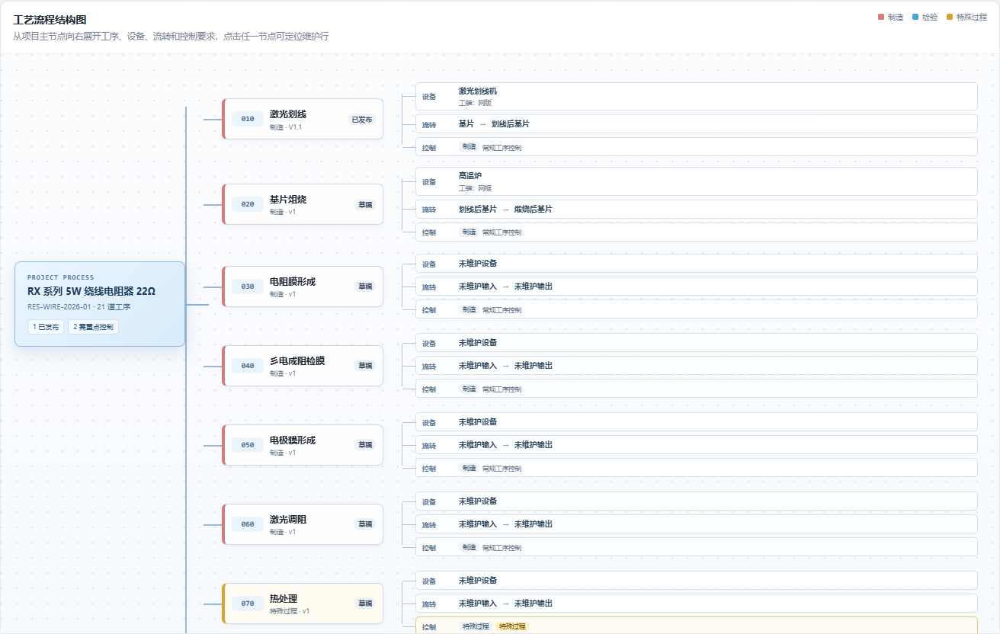
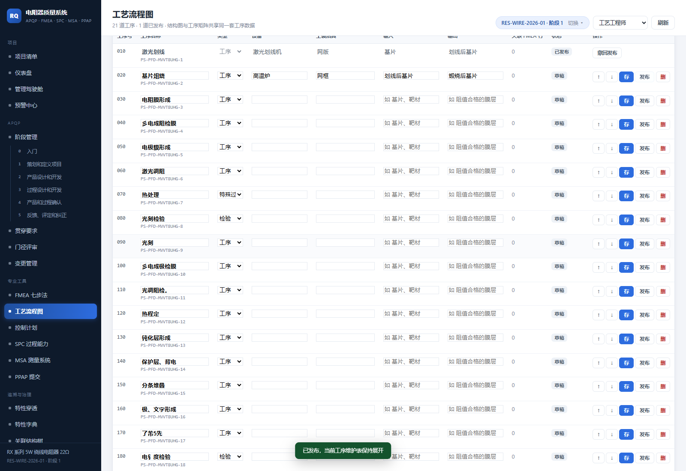

# 电阻器质量系统 V1.9 工艺流程结构树与维护表优化报告

> 版本：V1.9  
> 实施日期：2026-10-31  
> 范围：PFD 工艺流程可视化、工序维护表保存/发布交互

## 1. 工艺流程结构树

原“纵向流程地图 + 右侧矩阵”调整为“横向结构树 + 下方全宽矩阵”。

结构层级：

```text
当前项目
  -> 工序
       -> 设备 / 工装
       -> 输入 / 输出
       -> 工序类型 / 特殊过程 / CC / SC / 安全特性
```

页面行为：

- 项目根节点固定显示在结构树左侧，滚动工序时保持项目上下文可见。
- 工序按 PFD 的 `seq` 顺序向下分支。
- 制造、检验、特殊过程使用不同颜色区分。
- 项目根节点显示已发布工序数和重点控制工序数。
- 点击根节点、工序节点或明细节点，均可展开并定位工序维护行。
- 工序流程矩阵继续保留，并与结构树共享同一套 `process_step` 数据。
- 窄屏下只有结构树内部横向滚动，浏览器页面本身不产生横向溢出。

桌面效果：



## 2. 工序维护表

- 工序维护表改为默认展开。
- 点击“保存”后不再重绘整个页面，维护表保持展开，当前滚动位置不变。
- 点击“发布”时同时提交当前行已编辑的字段，减少“先保存再发布”的重复操作。
- 发布或撤回后会刷新工序状态，但保持维护表展开、页面纵向位置和维护表横向/纵向滚动位置。
- 已发布工序仍保持只读，需先撤回发布再编辑。

维护表效果：



## 3. 验证结果

### 3.1 自动化测试

```text
npm test
Smoke tests passed
```

### 3.2 浏览器真实交互

正式项目：`RES-WIRE-2026-01`，RX 系列 5W 绕线电阻器 22Ω。

| 检查项 | 结果 |
| --- | --- |
| 结构树工序节点 | 21 |
| 结构树明细节点 | 63 |
| 工序流程矩阵行 | 21 |
| 项目根节点首屏可见 | 通过 |
| 页面横向溢出（1600 px） | 0 |
| 页面横向溢出（390 px） | 0 |
| 维护表默认展开 | 通过 |
| 保存后保持展开 | 通过 |
| 保存后滚动位置 | 1611 -> 1611 |
| 发布后保持展开 | 通过 |
| 发布后滚动位置 | 1611 -> 1611 |
| JavaScript 页面错误 | 0 |

浏览器交互测试使用请求拦截模拟 PATCH 成功，仅验证前端状态和重绘行为，未修改正式工序数据。

## 4. 正式环境

```text
http://127.0.0.1:8848/?p=RES-WIRE-2026-01#pfd
```

浏览器实测发现正式项目中有若干疑似 OCR 工序名称，例如“基片俎烧”“彡电成阻检膜”“了芾5先”。本次未自动修改用户数据，建议在工序维护表中结合原始工艺文件逐条校对。
