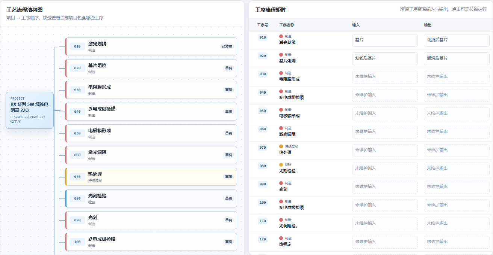

# 电阻器质量系统 V2.0 工艺流程页面职责与布局优化报告

> 版本：V2.0  
> 实施日期：2026-10-31  
> 范围：PFD 工艺流程结构图、工序流程矩阵、工序维护表

## 1. 模块职责

三个区域使用同一套 `process_step` 数据，但各自承担不同职责：

| 区域 | 展示内容 | 主要用途 |
| --- | --- | --- |
| 工艺流程结构图 | 工序号、工序名称、工序类型、状态 | 快速确认项目包含哪些工序 |
| 工序流程矩阵 | 工序号、工序名称、输入、输出 | 按工序快速对照输入与输出 |
| 工序维护表 | 工序号、名称、类型、设备、工装、输入、输出、FMEA 关联、状态及操作 | 完整数据维护、排序、保存和发布 |

点击结构图或矩阵中的工序，会展开维护表并定位到对应工序行。未发布工序会自动聚焦到名称输入框。

## 2. 布局与编号

桌面端：

```text
工艺流程结构图 50% | 工序流程矩阵 50%
                工序维护表 100%
```

- 左右卡片等高，实测宽度均为 650 px。
- 顶部区域高度约为当前视口的 62%，限制在 520 至 680 px。
- 维护表位于顶部区域下方并占满整行。
- 1180 px 以下改为上下排列，避免半屏内容过度压缩。

工序号统一为三位格式，例如 `010`、`020`、`210`。结构图、矩阵和维护表均由同一个标准化字段输出，实测 21 道工序的编号逐条一致。

效果截图：



## 3. 验证结果

自动化测试：

```text
npm test
Smoke tests passed
```

正式项目 `RES-WIRE-2026-01` 浏览器实测：

| 检查项 | 结果 |
| --- | --- |
| 结构图工序节点 | 21 |
| 结构图多余明细节点 | 0 |
| 矩阵行数 | 21 |
| 矩阵列 | 工序号、工序名称、输入、输出 |
| 维护表行数 | 21 |
| 三处工序号逐条一致 | 通过 |
| 左/右卡片宽度 | 650 / 650 px |
| 页面横向溢出 | 0 |
| 点击矩阵行定位维护行 | 通过 |
| 保存后维护表展开 | 通过 |
| 发布后维护表展开 | 通过 |
| 保存/发布后页面位置 | 保持不变 |
| 窄屏上下排列 | 通过 |
| JavaScript 页面错误 | 0 |

浏览器交互中的保存和发布使用请求拦截模拟成功，仅验证前端状态，不修改正式工序数据。

## 4. 正式入口

```text
http://127.0.0.1:8848/?p=RES-WIRE-2026-01#pfd
```
