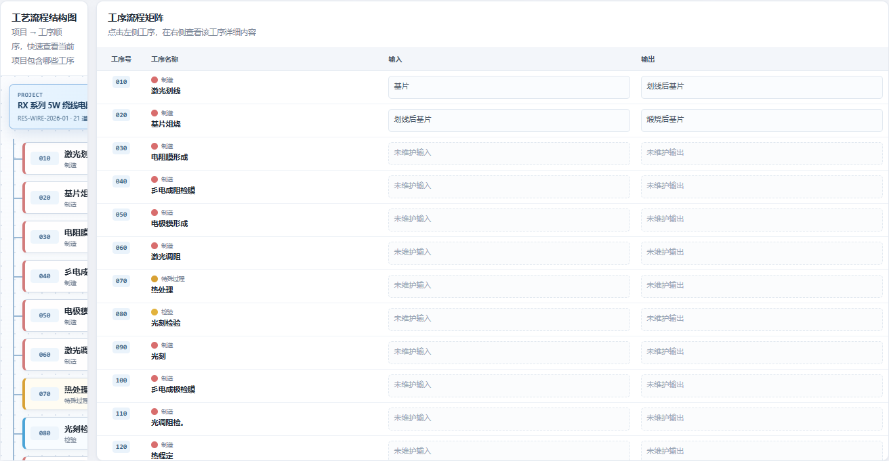
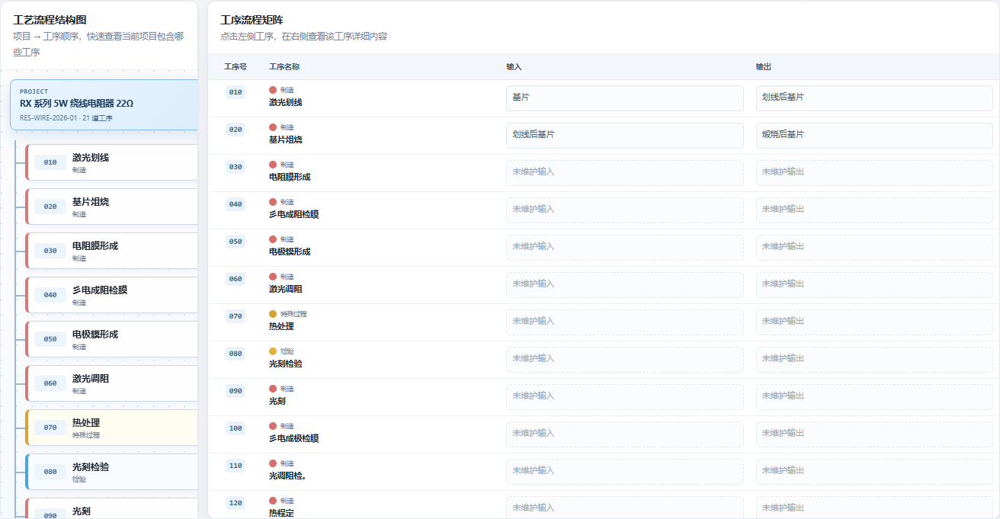
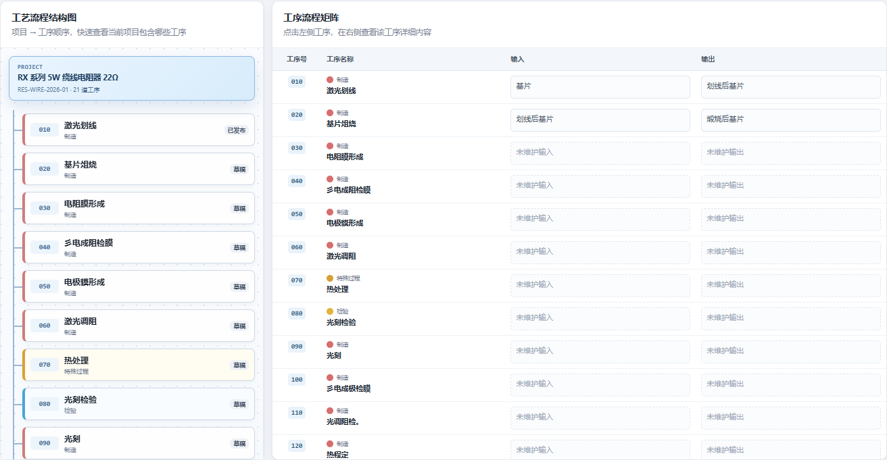
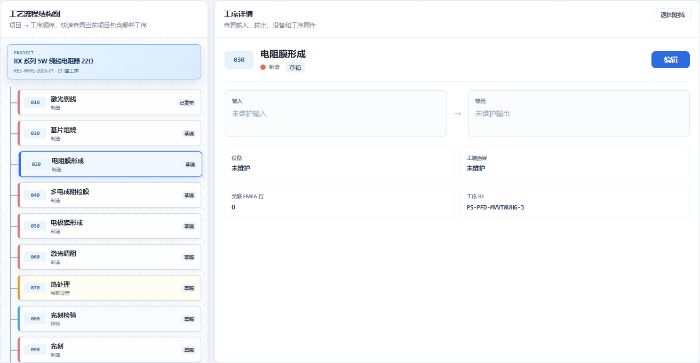

# 电阻器质量系统 V2.1 工艺流程比例与工序详情交互报告

> 版本：V2.1  
> 实施日期：2026-10-31  
> 范围：工艺流程结构图比例、工序详情、编辑定位

## 1. 比例对比

在 1600 px 桌面视口下，对同一正式项目分别测试三种结构图/矩阵比例：

| 比例 | 左栏宽度 | 右栏宽度 | 左栏横向裁切 | 结论 |
| --- | ---: | ---: | ---: | --- |
| 1:9 | 130 px | 1170 px | 202 px | 工序名称和状态无法完整显示，不采用 |
| 2:8 | 260 px | 1040 px | 72 px | 节点仍被横向裁切，不采用 |
| 3:7 | 390 px | 910 px | 0 px | 工序名称完整，信息密度和视觉平衡更好，采用 |







最终布局：

```text
工艺流程结构图 30% | 工序流程矩阵 70%
             工序维护表 100%
```

结构图节点改为紧凑型项目栏加工序列表。项目栏固定在结构图顶部，工序列表使用纵向树线连接，不再通过大面积留白撑开左栏。

## 2. 工序详情交互

默认状态：右侧展示全部工序的输入输出矩阵。

点击左侧任一道工序后：

1. 左侧工序进入选中状态。
2. 右侧切换为“工序详情”。
3. 展示工序号、名称、类型、状态、输入、输出、设备、工装、FMEA 行数和工序 ID。
4. 详情右上角提供“编辑”按钮。
5. 点击“编辑”自动展开工序维护表，滚动到对应工序行，并聚焦名称输入框。
6. 点击“返回矩阵”恢复全部工序矩阵。



## 3. 验证结果

```text
npm test
Smoke tests passed
```

正式项目 `RES-WIRE-2026-01` 浏览器验证：

| 检查项 | 结果 |
| --- | --- |
| 1:9 比例可读性 | 不通过，存在横向裁切 |
| 2:8 比例可读性 | 不通过，存在横向裁切 |
| 3:7 比例可读性 | 通过 |
| 点击树节点切换右侧详情 | 通过 |
| 详情展示输入输出及维护字段 | 通过 |
| 编辑按钮定位 `030` 维护行 | 通过 |
| 编辑按钮聚焦名称输入框 | 通过 |
| 返回矩阵 | 通过 |
| 保存后保持详情与维护表展开 | 通过 |
| 发布后保持详情与维护表展开 | 通过 |
| 窄屏工序详情单列布局 | 通过 |
| 保存/发布模拟不修改正式数据 | 通过 |
| JavaScript 页面错误 | 0 |

## 4. 正式入口

```text
http://127.0.0.1:8848/?p=RES-WIRE-2026-01#pfd
```
