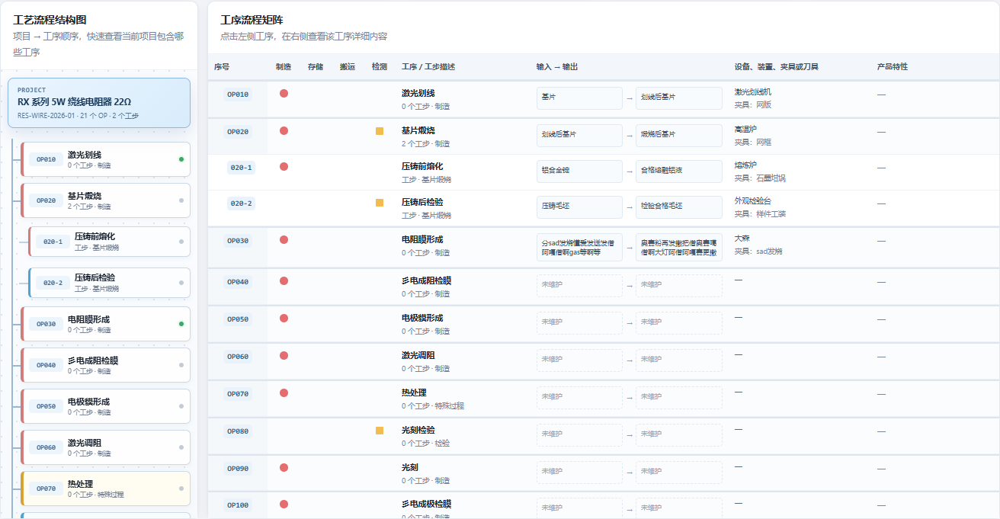
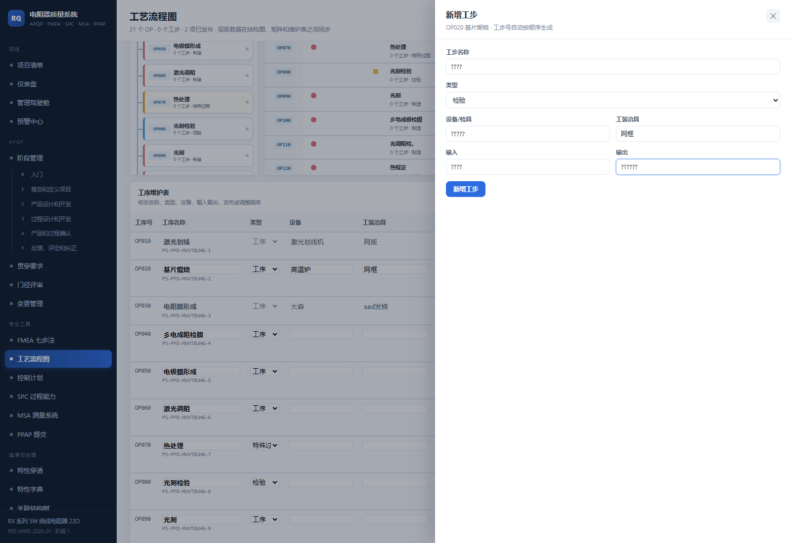

# 电阻器质量系统 V2.2 OP 工序与工步层级矩阵报告

> 版本：V2.2  
> 实施日期：2026-10-31  
> 范围：PFD 2/8 布局、OP/工步层级、参考式工序矩阵

## 1. 数据模型

`process_step` 新增 `parent_step_id`：

| 字段 | 含义 |
| --- | --- |
| `parent_step_id = NULL` | 顶层 OP 工序 |
| `parent_step_id = step_id` | 该 OP 下的工步 |

编号规则：

```text
OP010
  010-1
  010-2
  010-3
OP020
  020-1
  020-2
```

层级关系真实保存于数据库，不是前端拼装。结构图、矩阵、工序详情和工序维护表使用同一套父级关系与工序号。

## 2. 2/8 布局

桌面端结构图与矩阵比例调整为 `2fr / 8fr`：

- 1600 px 视口下，左栏 260 px，右栏 1040 px。
- 左侧结构图无横向裁切。
- 左侧仅显示 OP 编号、工序名称、OP/工步层级和状态点。
- 工步在 OP 下缩进显示。
- 右侧矩阵获得更多横向空间，完整展示参考图中的流程动作矩阵。



截图中 `OP020` 下的两个工步为浏览器请求拦截注入的展示样例，没有写入正式数据库。

## 3. 工序矩阵

矩阵列：

```text
序号
制造
存储
搬运
检测
工序 / 工步描述
输入 → 输出
设备、装置、夹具或刀具
产品特性
```

显示规则：

- OP 行使用强调背景，并汇总自身及子工步的活动类型。
- 工步行缩进显示，使用 `010-1` 这类三级编号。
- 制造使用红色圆点。
- 存储使用绿色菱形。
- 搬运使用蓝色三角形。
- 检测使用黄色方形。
- 输入输出继续保留，未维护内容使用虚线占位。
- 设备、夹具和特殊特性直接显示在对应工序或工步行。

## 4. 新增工步

未发布的顶层 OP 在维护表中提供“＋工步”按钮。

新增工步表单包含：

- 工步名称；
- 类型；
- 设备/检具；
- 工装治具；
- 输入；
- 输出。

工步号由系统自动生成。已发布 OP 需先撤回发布，才能新增工步。存在有效工步时，顶层 OP 不能直接删除。



## 5. 交互

- 点击左侧 OP，右侧展示该 OP 详情。
- 点击左侧工步，右侧展示该工步详情。
- 详情保留“编辑”按钮，点击后滚动到下方维护表对应行。
- 未发布工步会自动聚焦名称输入框。
- “返回矩阵”恢复完整层级矩阵。

## 6. 验证结果

```text
npm test
Smoke tests passed
```

自动化验证：

- 在未发布 OP 下创建工步。
- 工步自动生成 `020-1` 格式编号。
- 父工序返回正确 `child_count`。
- 存在工步时父工序禁止直接删除。
- OP 重排后，子工步继续跟随父工序并保持三级编号。
- 项目复制保留父子工序映射。

浏览器验证：

| 检查项 | 结果 |
| --- | --- |
| 左右比例 | 260 / 1040 px，2:8 |
| 左栏横向裁切 | 0 |
| 树中 OP/工步节点 | 通过 |
| 矩阵 OP/工步分组 | 通过 |
| 动作符号汇总 | 通过 |
| 工步详情 | 通过 |
| 编辑定位工步行 | 通过 |
| 新增工步表单提交 | 通过 |
| 移动端内部横向滚动 | 通过 |
| 页面整体横向溢出 | 0 |
| JavaScript 页面错误 | 0 |

## 7. 正式环境

```text
http://127.0.0.1:8848/?p=RES-WIRE-2026-01#pfd
```

正式数据库迁移前备份：

```text
data/backups/qms-pre-op-substep-20261031-124707.db
data/backups/qms-pre-op-substep-20261031-124707.db-wal
data/backups/qms-pre-op-substep-20261031-124707.db-shm
```
