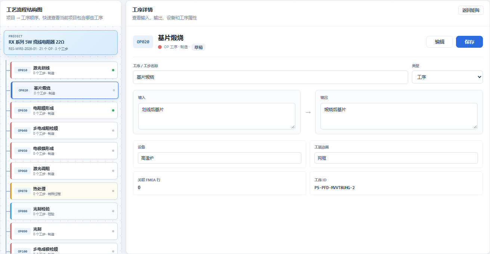
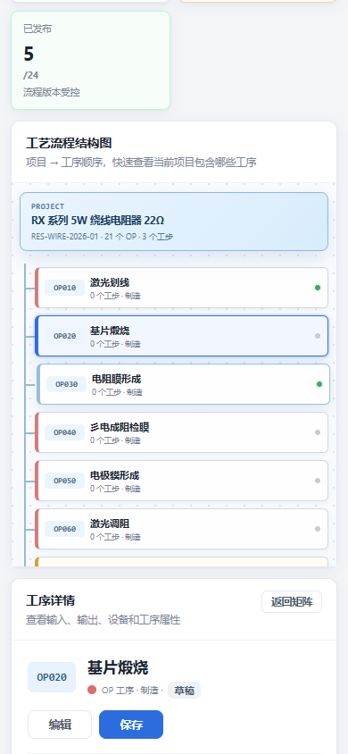

# 电阻器质量系统 V2.3 工序详情编辑与比例优化报告

> 版本：V2.3  
> 实施日期：2026-10-31  
> 范围：PFD 2.5/7.5 布局、工序详情编辑保存、跨区域同步

## 1. 布局比例

结构图与矩阵比例调整为 `2.5fr / 7.5fr`，即左栏 25%、右栏 75%。

1600 px 视口实测：

| 区域 | 宽度 |
| --- | ---: |
| 工艺流程结构图 | 325 px |
| 工序流程矩阵 | 975 px |
| 页面整体横向溢出 | 0 |
| 左栏内部横向裁切 | 0 |
| 矩阵内部横向裁切 | 0 |



## 2. 工序详情编辑

工序详情由只读展示改为可编辑表单，支持：

- 工序 / 工步名称；
- 类型；
- 输入；
- 输出；
- 设备；
- 工装治具。

以下内容保持只读：

- 关联 FMEA 行数；
- 工序 ID；
- 特殊特性。

详情右上角保留两个独立操作：

| 按钮 | 行为 |
| --- | --- |
| 编辑 | 展开并滚动到下方工序维护表对应行，定位名称输入框 |
| 保存 | 调用工序更新接口，保存当前详情字段 |

### 保存同步

详情保存成功后，会重新加载当前工序数据，并保持当前选中工序。以下区域同步更新：

1. 工序详情；
2. 工序维护表；
3. 左侧结构树；
4. 右侧工序矩阵。

修复了一处数据合并顺序问题：原先 PPAP 证据缓存中的旧工序信息会覆盖刚保存的主工序数据，导致维护表已更新而树和矩阵仍显示旧值。现在以 `process_step` 主数据为准，证据数据仅补充特殊特性等附加字段。

### 版本控制

已发布工序：

- 详情字段只读；
- 类型下拉禁用；
- 保存按钮禁用；
- 仍需先撤回发布再编辑。

## 3. 移动端

- 结构图与矩阵改为上下排列。
- 工序详情表单改为单列。
- 编辑和保存按钮完整显示。
- 页面整体无横向溢出。



## 4. 验证结果

```text
npm test
Smoke tests passed
```

浏览器验证：

| 检查项 | 结果 |
| --- | --- |
| 左右比例 | 325 / 975 px，25% / 75% |
| 可编辑详情字段 | 6 |
| 保存按钮 | 可见并可用 |
| 保存请求 | 仅发送 1 次 PATCH |
| 详情同步 | 通过 |
| 维护表同步 | 通过 |
| 结构树同步 | 通过 |
| 矩阵同步 | 通过 |
| 编辑按钮定位维护行 | 通过 |
| 已发布工序保存禁用 | 通过 |
| 移动端单列表单 | 通过 |
| JavaScript 页面错误 | 0 |

保存同步验证使用浏览器请求拦截完成，未在正式数据中保留测试值。

## 5. 正式入口

```text
http://127.0.0.1:8848/?p=RES-WIRE-2026-01#pfd
```
